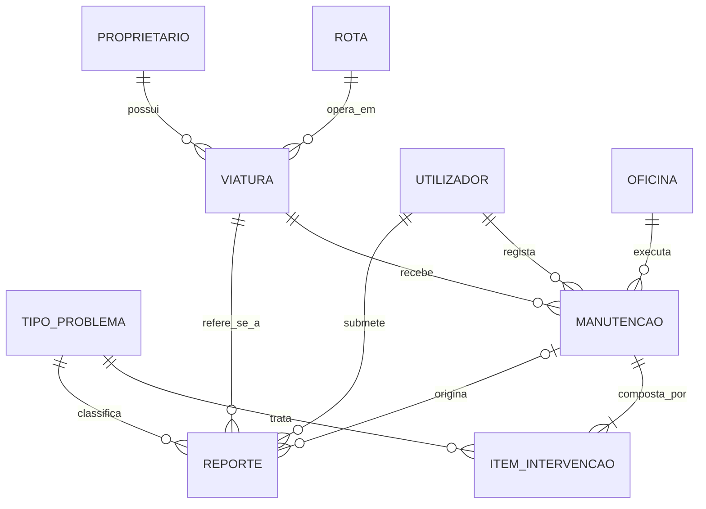

# Modelo Relacional e Especificação do Diagrama ER

**Tema:** Sistema Web de Registo e Acompanhamento das Condições de Manutenção dos Transportes Semicolectivos (chapas) na Cidade da Beira
**SGBD:** MySQL

---

## 1. Entidades e atributos (para o diagrama ER)

| Entidade | Tipo | Atributos (PK sublinhada em *italico*) |
|---|---|---|
| UTILIZADOR | Forte | *id_utilizador*, nome, email, telefone, senha_hash, perfil (passageiro/gestor), data_registo |
| PROPRIETARIO | Forte | *id_proprietario*, nome, nr_bi, telefone, endereco |
| ROTA | Forte | *id_rota*, codigo, origem, destino, distancia_km |
| VIATURA | Forte | *id_viatura*, matricula, marca, modelo, ano_fabrico, nr_lugares, estado (ativa/em_manutencao/inativa) |
| TIPO_PROBLEMA | Forte | *id_tipo*, nome, descricao, gravidade (baixa/media/alta) |
| OFICINA | Forte | *id_oficina*, nome, bairro, telefone, responsavel |
| MANUTENCAO | Forte | *id_manutencao*, tipo (preventiva/corretiva), data_agendada, data_realizada, estado (agendada/em_curso/concluida), custo_total |
| REPORTE | Forte | *id_reporte*, data_reporte, descricao, estado (aberto/em_analise/resolvido) |
| **ITEM_INTERVENCAO** | **Fraca** (depende de MANUTENCAO) | *nr_item* (chave parcial), descricao, custo, estado (pendente/feito) |

## 2. Relacionamentos, cardinalidade e participação

| Relacionamento | Entidades | Cardinalidade | Participação |
|---|---|---|---|
| **possui** | PROPRIETARIO – VIATURA | 1:N | PROPRIETARIO: parcial (pode não ter viaturas registadas); VIATURA: **total** (toda viatura tem proprietário) |
| **opera em** | ROTA – VIATURA | 1:N | ROTA: parcial; VIATURA: **total** |
| **submete** | UTILIZADOR – REPORTE | 1:N | UTILIZADOR: parcial; REPORTE: **total** |
| **refere-se a** | VIATURA – REPORTE | 1:N | VIATURA: parcial; REPORTE: **total** |
| **classifica** | TIPO_PROBLEMA – REPORTE | 1:N | TIPO_PROBLEMA: parcial; REPORTE: **total** |
| **recebe** | VIATURA – MANUTENCAO | 1:N | VIATURA: parcial; MANUTENCAO: **total** |
| **executa** | OFICINA – MANUTENCAO | 1:N | OFICINA: parcial; MANUTENCAO: **total** |
| **regista** | UTILIZADOR (gestor) – MANUTENCAO | 1:N | UTILIZADOR: parcial; MANUTENCAO: **total** |
| **origina** | MANUTENCAO – REPORTE | 1:N | MANUTENCAO: parcial (nem toda manutenção vem de um reporte, p. ex. preventiva); REPORTE: **parcial** (um reporte pode ainda não ter manutenção) |
| **é composta por** (identificador) | MANUTENCAO – ITEM_INTERVENCAO | 1:N | MANUTENCAO: parcial; ITEM_INTERVENCAO: **total** (depende da manutenção) |
| **trata** | TIPO_PROBLEMA – ITEM_INTERVENCAO | 1:N | TIPO_PROBLEMA: parcial; ITEM_INTERVENCAO: **total** |

**Nota sobre a entidade fraca:** ITEM_INTERVENCAO não existe sem a MANUTENCAO a que pertence. O seu identificador é composto: `(id_manutencao, nr_item)`. O `nr_item` (1, 2, 3...) só é único dentro de cada manutenção.

**Nota sobre N:M:** entre MANUTENCAO e TIPO_PROBLEMA existe, na prática, uma relação N:M (uma manutenção resolve vários tipos de problema e um tipo aparece em várias manutenções). Ela fica resolvida pela entidade fraca ITEM_INTERVENCAO.

---

## 3. Modelo relacional

PK = chave primária, FK = chave estrangeira, UQ = único, NN = não nulo.

```
UTILIZADOR (id_utilizador PK, nome NN, email UQ NN, telefone, senha_hash NN,
            perfil NN, data_registo NN)

PROPRIETARIO (id_proprietario PK, nome NN, nr_bi UQ NN, telefone NN, endereco)

ROTA (id_rota PK, codigo UQ NN, origem NN, destino NN, distancia_km NN)

VIATURA (id_viatura PK, matricula UQ NN, marca NN, modelo NN, ano_fabrico NN,
         nr_lugares NN, estado NN,
         id_proprietario FK -> PROPRIETARIO NN,
         id_rota FK -> ROTA NN)

TIPO_PROBLEMA (id_tipo PK, nome UQ NN, descricao, gravidade NN)

OFICINA (id_oficina PK, nome NN, bairro NN, telefone, responsavel NN)

MANUTENCAO (id_manutencao PK, tipo NN, data_agendada NN, data_realizada,
            estado NN, custo_total,
            id_viatura FK -> VIATURA NN,
            id_oficina FK -> OFICINA NN,
            id_gestor FK -> UTILIZADOR NN)

REPORTE (id_reporte PK, data_reporte NN, descricao NN, estado NN,
         id_utilizador FK -> UTILIZADOR NN,
         id_viatura FK -> VIATURA NN,
         id_tipo FK -> TIPO_PROBLEMA NN,
         id_manutencao FK -> MANUTENCAO  (pode ser NULL))

ITEM_INTERVENCAO (id_manutencao PK+FK -> MANUTENCAO,
                  nr_item PK,
                  descricao NN, custo NN, estado NN,
                  id_tipo FK -> TIPO_PROBLEMA NN)
```

## 4. Ordem de criação e de inserção (respeita as chaves estrangeiras)

1. UTILIZADOR, PROPRIETARIO, ROTA, TIPO_PROBLEMA, OFICINA (sem dependências)
2. VIATURA (depende de PROPRIETARIO e ROTA)
3. MANUTENCAO (depende de VIATURA, OFICINA, UTILIZADOR)
4. REPORTE (depende de UTILIZADOR, VIATURA, TIPO_PROBLEMA, MANUTENCAO)
5. ITEM_INTERVENCAO (depende de MANUTENCAO e TIPO_PROBLEMA)

Para eliminar, a ordem é a inversa (primeiro as tabelas dependentes).

## 5. Volume de dados (requisito da ficha: mínimo 20 registos por tabela)

| Tabela | Registos |
|---|---|
| UTILIZADOR | 20 |
| PROPRIETARIO | 20 |
| ROTA | 20 |
| VIATURA | 20 |
| TIPO_PROBLEMA | 20 |
| OFICINA | 20 |
| MANUTENCAO | 20 |
| REPORTE | 20 |
| ITEM_INTERVENCAO | 20 |
| **Total** | **180** |

---

## 6. Diagrama ER em Mermaid (para colar no draw.io)

No draw.io: **Arrange > Insert > Advanced > Mermaid**, cola o código abaixo, ajusta o layout e exporta como `diagrama_er.png`. Como a ficha pede cardinalidade e participação, confirma no diagrama final que estão indicadas (ou acrescenta uma legenda).


